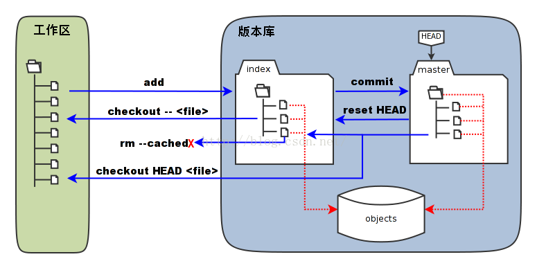

########################################
Git 基础与工作流
########################################

************
Git 常用命令 
************

.. code-block:: sh

    git config --global core.editor vim  # 配置默认编辑器 vim

    # 强制覆盖远程标签（高风险操作）
    git tag -f v2.0.0-Alpha1          # 先更新本地标签到最新提交
    git push -f origin v2.0.0-Alpha1  # 强制推送到远程

    # submodule
    git clone <repository> --recursive      # 递归的方式克隆整个项目
    git submodule update --init --recursive     # 更新子模块
    git submodule update --recursive --remote   # 更新子模块
 
    git submodule foreach git pull origin master # 拉取所有子模块

    # 本地仓库合并，以 dev -> master 为例

    git push . dev:master  # 当前所在支dev 

    git merge  dev        # 当前所在支master

* `Git Community Book 中文版 <http://gitbook.liuhui998.com/index.html>`_
* `Git 教程 <https://git-scm.com/book/zh/v2>`_
* `Pro Git(中文版)  <http://git.oschina.net/progit/>`_
* `码云平台帮助文档 <http://git.mydoc.io/>`_

* `learngitbranching <https://learngitbranching.js.org/?locale=zh_CN>`_

-------------

* `Git使用流程规范 <http://www.jizhuomi.com/software/436.html>`_
* `Gitlab 项目分支管理的一种策略 <https://segmentfault.com/a/1190000006062453>`_
* `Git rebase简介 <https://blog.csdn.net/hudashi/article/details/7664631/>`_

----

* `Git分支管理策略  <https://www.ruanyifeng.com/blog/2012/07/git.html>`_
* `git cherry-pick 教程 (*重点*) <https://www.ruanyifeng.com/blog/2020/04/git-cherry-pick.html>`_

git config 
============

.. code-block:: sh

    git config --global -e  # 默认为 --global
    git config  -e    # or git config --edit
    git config --list 
    git config --global core.editor vim  # 配置默认编辑器 vim

    #  设置代理服务- 全局
    git config --global http.proxy  socks5://127.0.0.1:1080 # 代理服务器
    git config --global https.proxy socks5://127.0.0.1:1080 
    
    git config --global --unset http.proxy   # 撤销代理服务器
    git config --global --unset https.proxy

    git config --global --get http.proxy   # 查询理服务器
    git config --global --get https.proxy

    #设置代理服务 - 只对github.com
    git config --global http.https://github.com.proxy socks5://127.0.0.1:1080
     
    #取消代理
    git config --global --unset http.https://github.com.proxy

    # 记住密码
    $ git config credential.helper store # 永久记住密码
    $ git config credential.helper cache  # 临时记住密码15分钟
    $ git config credential.helper 'cache --timeout=3600' # 临时记住密码1小时

撤销与回退 
============

.. code-block:: sh

    $ git rm    --cached path              # 撤销add 文件
    $ git rm -r --cached path              # 撤销add 目录

    $ git checkout <commit_id> <path>      # 回退单个文件到某一次提交
    $ git checkout <branc_name> -- <path>  # checkout file from a brach

    $ git revert <commit_id>
    # git revert是用一次新的commit来回滚之前的commit, 而git reset是直接删除指定的commit。

    $ git commit --amend                   # 修改commit 备注信息

Create New branch   
==================

.. code-block:: sh

    $ git branch  <new_branch_name> <commit_id>  
    $ git checkout -b  <new_branch_name> <commit_id>  
    $ git branch -a   # 查看分支（本地 + 远程)  
    $ git push origin --delete <new_branch_name>   # 删除远程分支

Gitignore   
============

.. code-block:: sh

    # 忽略,指定文件之外的所有文件
    $ tee .gitignore <<-'EOF'
    /*

    !Dockerfile
    !init.sh
    !sources.list
    !*.md
    EOF

`git log <https://blog.csdn.net/wh_19910525/article/details/7468549>`_
=============================================================================

.. code-block:: sh

    $ git log --stat  #  --stat，查看修改了那些文件,仅显示简要的增改行数统计

    # https://www.cnblogs.com/Sir-Lin/p/6064844.html
    $ git log -- filename  <path>  # 查看某文件的修改历史
    $ git show <commit-id> <path>
    $ git log -b <branch_name> 
    $ git log --graph --all   

* `git cherry-pick <https://www.jianshu.com/p/08c3f1804b36>`_

.. code-block:: sh

    $ git cherry-pick xxx

.. code-block:: sh

    $ git add  <path>

    #####################
    # about git diff
    #####################

    $ git diff --cached
    # Compare files from two different branches
    $ git diff <branch_name> <another_branch_name> -- <path>
    
    # 比较不同分支，不同文件
    $ git diff 4.2.0-dev-fix:./src/model/offline_vm/hotplug_usb.py \
               4.2.0-vgt_passthough:./src-core/model/offline_vm/hotplug_usb.py

.. code-block:: sh

    $ git pull --rebase origin master

git lfs  
====================

.. code-block:: sh

    apt-get install git-lfs
    git lfs clone <repo>

git submodule 
================

.. code-block:: sh
    
    git submodule add url path/to/name 
    git submodule add <repo> <dir>          # 添加 子模块
    git submodule add -b tractor --force <url> path
                                            # 删除 子模块
					    

    git submodule init                      # 初始化子模块
    git submodule status                    # 查看子模块
    git submodule update                    # 

    ##########################
    #    跟新，子模块
    ##########################
    git submodule foreach git pull origin master # 拉取所有子模块
    git submodule sync                      # 
    git add .                               # 
    git push origin master                  # 

    git clone <repository> --recursive      # 递归的方式克隆整个项目
    git submodule update --init --recursive     # 更新子模块
    git submodule update --recursive --remote   # 更新子模块
    
* `Getting Git Submodule To Track A Branch <https://www.activestate.com/blog/getting-git-submodule-track-branch/>`_

git tag 
============

* `Git Tag <https://git-scm.com/book/zh/v2/Git-%E5%9F%BA%E7%A1%80-%E6%89%93%E6%A0%87%E7%AD%BE>`_

.. code-block:: sh

    # 打TAG也就是发布版本
    $ git tag -a v1.4 -m "version 1.4"
    $ git show v1.4   # 查看
    $ 
    $ git push --tags
    $ git push my_origin --tags

    $ git tag -d  tag_name

如果还不能理解可以到这里看看是linus是怎么给Linux内核打的TAG，TAG看起来像什么：https://github.com/torvalds/linux/releases

git patch   
============

.. code-block:: sh

    ########################################
    # 当前分支，打patch
    ########################################
    # 1、生成patch(在代码修改后没有commit之前的状态执行，进入想生成patch的目录即可)
    git diff > project.patch
    # 2、打patch，方法和linux的diff一样
    patch -p0 < project.patch
    git apply project.patch  //也可用这个命令打patch
    
    ###################################################  
    # 不同分支,不同文件，打pacth, 
    # 将 my_dev 对比 master的修改，打成path
    ################################################### 
    git diff master my_dev -- src/view/setting/other_seting.py > other_seting.py.pacth

    # 此时branch 位于 master 
    git apply other_seting.py.pacth

************
打包发布   
************

.. code-block:: sh

        git archive --format zip --output /path/to/file.zip master # 将 master 以zip格式打包到指定文件

************
Send Mail   
************

.. code-block:: sh

    $ sudo apt-get install -y git-email  
    
    # config 
    $ git config --local user.email "jiang_xmin@massclouds.com"
    $ git config --local user.name  "jiang_xmin"
    $ git config --local sendemail.smtpserver     "smtp.qiye.163.com"
    $ git config --local sendemail.smtpencryption "tls"
    $ git config --local sendemail.smtpuser        "jiang_xmin@massclouds.com"
    $ git config --local sendemail.smtpserverport "25"
    # git config --local sendemail.smtppass       'passwd'

    $ git config --local sendemail.annotate     true
    $ git config --local sendemail.chainreplyto true
    $ git config --local sendemail.confirm      always 
    $ git config --local sendemail.to jxm_zn@163.com  # sendo to 

    # send 
    $ git send-email --no-chain-reply-to --annotate --confirm=always --to=jxm_zn@163.com  master -1 

